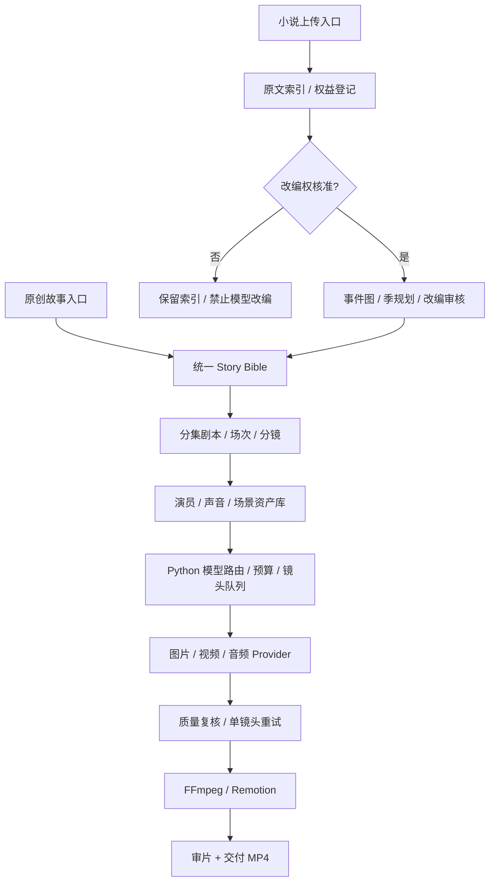

# AI Short Drama Factory | AI 短剧自动化工厂

> **真人男女主短剧优先的 Python 影视生成流水线；同一制作总线支持 2D 漫剧、3D 动画，并为小说改编保留独立入口。**
>
> **当前版本：v0.1 工程骨架 + PR-11 离线端到端 MP4 技术预览（有可播放 MP4，尚无 AI 影视成片）。** 请勿把 Mock 完成状态理解为生成出 MP4。

## 1. 我们究竟要做什么？

输入原创故事，或者上传**自有/已获影视改编授权**的小说，依次完成：

1. **内容整理**：原创梗概 / 小说章节、人物关系、事件图与版权记录。
2. **编剧改编**：Story Bible（全剧圣经）→ 季规划 → 分集剧本 → 场次 / 可制作分镜。
3. **虚拟演员**：固定角色 ID、脸、身材、服装、表情、声音、与其他演员的关系。
4. **视觉生产**：逐镜头选择素材复用、图片生成、图生视频或视频编辑；保存参考图版本与任务 ID。
5. **对白与剪辑**：稳定音色、口型、字幕、音乐音效、FFmpeg/Remotion 合成。
6. **质检与交付**：检查演员/服装/场景/道具连续性、音画同步、模型实际成本、版权和 AI 内容标识。

系统不是“一个模型写 Prompt 并生成完整视频”。**Python 管流程，专业模型产素材，人审核关键节点。** 质量和合格镜头成本优先于单次 API 生成报价。

### 架构边界



## 多栏目生产隔离（PR-01 已实现）

- 正式层级：**栏目 Column → 剧集 Series → 分集 Episode → 生产 Run**。
- 每个剧集独立的角色、场景、声音、道具及 Story Bible 版本库；同名素材在不同剧集是独立的 `asset_id`。
- 新建分集时核对演员/场景/参考素材归属，禁止未经授权的跨剧引用。
- 原有 `/api/v1/projects` 保留：旧项目属于默认栏目，SQLite 自动迁移保留旧数据。
- Streamlit 可创建栏目、选择栏目下剧集并登记独立资产；**真正多 Worker 并行视频生成仍待 M3 实施**。
- [详细架构、API、迁移和验收说明](docs/MULTI_COLUMN.md)。

### Google Drive 私有视频资产库（PR-25）

已经开始把 Google Drive 作为**优先云端视频存储**：已审核且经 SHA-256 校验的 MP4 可以进入独立的剧集 / 分集 / 镜头文件夹，远端读取并重新计算哈希后才登记 Drive File ID；也能把云端素材恢复到本地资产库再重新合成，且不触发任何 AI 视频模型。默认上传和读取门禁关闭；目前只通过 FakeDrive 客户端测试，**未向个人 Google Drive 上传真实文件**。适用于用户 OAuth 2.0，ChatGPT 已连接的 Drive 并不会自动把凭证授予 GitHub Actions。见 [GOOGLE_DRIVE_STORAGE](docs/GOOGLE_DRIVE_STORAGE.md)。

### R2/S3 私有云端单文件人工验收入口（PR-24）

已加入 **仅手动启动** 的 GitHub Actions：从零生成一个完全虚构、零 AI 费用的 2 秒 MP4，向私有 Bucket 上传一个已验收的分集文件，再下载、校验 SHA-256 和媒体流；只上传不含密钥的验收 JSON。默认不会运行，须仓库拥有者设置 R2/AWS 私有 Secrets，并输入确认词；运行会产生少量对象存储/请求费用。未接入真实 Bucket 前仅有 FakeS3 CI 测试，不应声称云端已实测。见 [CLOUD_STORAGE](docs/CLOUD_STORAGE.md)。

### R2/S3 私有云视频备份适配器（PR-23a）

新增与已审核本地 `stored_artifacts` 对接的可选 R2/AWS S3 对象存储，支持私有目录、条件写入、不覆写已有对象，以及**上传后远程完整读取并逐字节 SHA256 验收**。从云端恢复的 MP4 也会重新检查哈希和媒体格式，才能回到本地资产账本。默认双门禁关闭，不配置凭证也能用 FakeS3 跑所有回归测试。**本阶段未做真实云端上传/费用验收、没有公网下载或签名链接，Bucket 私有策略须由运维配置。** 详见 [CLOUD_STORAGE](docs/CLOUD_STORAGE.md)。

### 独立存储资产恢复到新工作目录（PR-22）

镜头和成片发布到独立资产库后，即使 FFmpeg 原工作目录已经删除，也可使用 `restore_stored_artifact` 恢复 MP4，或用 `recompose_from_stored_shots` 把已完成镜头重新合成为可播放分集；未完成镜头显示为技术占位画面。重新合成**不会再次调用收费视频模型**。存储仍在本地，尚未接通云存储与身份认证。详见 [ARTIFACT_STORAGE](docs/ARTIFACT_STORAGE.md)。

### 已完成视频的独立持久化存储（PR-21）

现在离线 Worker 与已恢复 Google 镜头的合成流程可选择把真实 MP4 镜头/成片发布到**独立本地资产目录**。发布前校验归属、实际 MP4 流、时长和 SHA256；保存后按剧集/分集隔离，重复发布不会覆写对象。即使删除 FFmpeg 临时制作目录，存储区里的资产仍可重新验证和读取。**这不是远程 R2/S3，也不是永久备份承诺；未启用公开下载 API 或云端自动收费。** 详见 [ARTIFACT_STORAGE](docs/ARTIFACT_STORAGE.md)。

### 多栏目生产状态与预算只读总览（PR-20）

新增 `production_operations(db, column_id=..., series_id=...)`，可对各个栏目和剧集分别汇总镜头状态、已提交但未核实费用、异常租约、下载恢复锁，以及栏目/剧集/Provider 预算占用。**只读内部 Python 函数，未向公网开放未鉴权接口，也不调用模型。** 详见 [OPERATIONS_MONITOR](docs/OPERATIONS_MONITOR.md)。

### Google 已生成视频的镜头级恢复入库（PR-19）

新增 **仅下载既有 Google 视频** 的镜头级恢复接口：先人工绑定 Google Files ID 到已经提交且拥有供应商 Task ID 的 Google 镜头工作项，再校验下载的 MP4、计算 SHA256 并写回对应镜头账本。支持下载后中断恢复、独立剧集素材隔离、针对指定已恢复镜头重新合成完整 MP4。默认不调用任何付费视频生成接口；账单仍以 Google 为准。详见 [GOOGLE_EXISTING_VIDEO_RECOVERY](docs/GOOGLE_EXISTING_VIDEO_RECOVERY.md)。

### 多条短剧线并行离线 Worker（PR-18）

已经可以让同一数据库的多部不同短剧同时领取独立的 Fake 镜头任务，使用 FFmpeg/Pillow 真正合成 MP4，并将每个成功镜头的文件哈希写回各自的任务账本。重复运行会使用已有缓存；某个剧集失败不会自动重新生成其他剧集的镜头。**Fake Worker 不调用任何付费图片/视频/TTS Provider，也不代表真正 AI 视频批量生产已经完成。** 详见 [OFFLINE_WORKERS](docs/OFFLINE_WORKERS.md)。

### 栏目、剧集、供应商三级费用与并发门禁（PR-17）

新增纯离线预算政策及原子预留，Worker 必须取得当日三层预算预留后才能进入付费生成意图。多部剧共享栏目总额，剧集和供应商可单独设限；确认过的实际费用和未结算预留都会占用额度。**不是供应商账单硬封顶，也没有启用自动付费 Worker。** 详见 [BUDGET_GATES](docs/BUDGET_GATES.md)。

### 镜头级任务状态与安全恢复（PR-16a）

增加独立的 `shot_jobs` / `shot_job_events` SQLite 账本，支持多剧集隔离、不可变幂等键、Worker 租约和供应商任务 ID 回填。**付费请求前必须先持久化提交意图**；一旦回执丢失则阻止自动二次计费，只有人工核查后才能决定恢复。这个阶段仅是离线任务控制模块，**没有真正启动云端批量生成，也没有账单硬上限**。详见 [镜头任务账本](docs/SHOT_JOB_LEDGER.md)。

### Gemini Omni 单镜头视频实测入口（PR-13a）

已经根据 Google 官方 Interactions API 建立受控的 `gemini-omni-1.1-flash` 视频适配器，包括 FakeProvider、Google Files URI 轮询/下载、内联视频读取、本地 FFprobe 检查，以及将真实视频放进我们的 6 秒混合分集。**测试工作流默认关闭**，仅在仓库拥有者手动输入 `GENERATE_ONE_PAID_VIDEO` 并通过密钥及双重批准后可能产生费用。目前还没做真实视频模型试片，普通 CI 仅离线 stub 测试。见 [OMNI_VIDEO_SMOKE](docs/OMNI_VIDEO_SMOKE.md)。

### 可替换的视频模型素材接口（PR-12）

离线成片可以按镜头导入本地 MP4/MOV/WEBM/MKV，检查文件哈希、时长及视频轨并转成统一的 H.264/AAC，重合成时复用其他不变的镜头。GitHub CI 样片的第 2 镜头现已换为本地 FFmpeg 生成的**动态测试图案**，后续 Gemini/Seedance/Kling 真实输出可以从这个入口接入；当前没有调用真实视频模型。见 [视频导入与成片文档](docs/OFFLINE_E2E.md)。

### 全流程离线可播放 MP4 技术预览（PR-11）

已接通从 Story Bible / 人物场景资产 / 结构化分镜，经明确审核、逐镜占位视频生成、镜头缓存、静态字幕和合成提示音，直到 FFmpeg 产出 **H.264 + AAC + mov_text 字幕** 的真实可播放竖屏 MP4。GitHub Python CI 自动生成 6 秒 `offline-end-to-end-mp4` Artifact，可以下载实际样片，不用 Google API Key，费用为零。它是**静态预览卡片而不是真人 AI 视频**。详见 [离线成片说明](docs/OFFLINE_E2E.md)。

### 单张 Google 演员定妆照：人工实测入口（PR-09）

已提供 GitHub Actions 手动 Workflow：必须仓库所有者设置 `GEMINI_API_KEY` 私有 Secret，选择 `main` 并输入精确确认词后才可能调用 **一次** Google 图片模型，生成单张虚构成年演员的 JPEG（`.jpg`）并保存 3 天的私有 Artifact。**默认 CI、API、小说解析、PR 均不触发付费请求，当前尚未真正做过试片。** [详细操作及费用风险](docs/GOOGLE_IMAGE_SMOKE_TEST.md)。

### Google Nano Banana 图像适配器（PR-08a）

已实现 Gemini Interactions API 的 Google 图片 Provider 和 FakeProvider。已根据真实 API 错误将不受支持的 PNG 响应修复为 JPEG，详见 [修复记录](docs/GOOGLE_IMAGE_PROVIDER.md)。真实调用要求 `DRAMA_ENABLE_PAID_GENERATION=YES`、人工逐次批准和本机 `GEMINI_API_KEY`；目前 **HTTP API 不暴露真实调用接口，也没有做过付费真人图片测试**。见 [Google Image Provider](docs/GOOGLE_IMAGE_PROVIDER.md)。

### 演员、场景与声样参考媒体版本（PR-07a）

新增系列专属 `asset_references`，记录角色定妆参考、服装、场景、音色样本等的 SHA256、来源许可、同意记录与批准版本。**目前仅元数据注册，不上传或生成图片/音频**。详见 [ASSET_REFERENCES](docs/ASSET_REFERENCES.md)。

### 小说版权审核与调用门禁（PR-06a）

记录人工审核版本、影视改编范围、语言/地域/媒介、有效期、第三方 AI 处理许可，并提供 `rights-eligibility` 查询。当前没有管理员认证，**只能作为本地开发和待核实声明；即使资格通过也不会启用外部模型**。详见 [NOVEL_RIGHTS](docs/NOVEL_RIGHTS.md)。

### 长篇小说任务分块（PR-05a）

新增小说章节级离线 chunk 清单与幂等准备 API；记录绝对偏移、原文片段哈希和 pending 状态，不返回正文也不发送给 AI。详见 [NOVEL_CHUNKS](docs/NOVEL_CHUNKS.md)。这不是自动情节抽取，真实 Provider 尚未开启。

### 小说改编 Blueprint 数据 Schema（PR-04）

新增独立 `NovelSource / SourceSpan / CharacterMention / PlotEvent / SeasonPlan` 数据结构，并校验小说哈希、章节边界、人物关联、情节因果与分集事件映射。这是离线结构校验，**还不是自动拆集**。参见 [小说 Schema](docs/NOVEL_SCHEMAS.md)。

### 剧本验证和人工提交（PR-03）

`POST /api/v1/series/{series_id}/screenplays/validate` 读取结构化剧本和对白，对角色与场景引用、镜头时长、说话人和跨剧隔离逐一检查；`/commit` 需要 `reviewed_by_operator=true`，仅保存 Episode 草稿，不自动生成视频。审阅了 [Drama Skills](https://github.com/zenstory-ai/drama-skills) 的 MIT 许可及分层工作流，但没有运行第三方安装脚本；参见 [审计与剧本契约](docs/SCREENPLAY_SKILLS.md)。

### 编剧模拟接口（PR-02）

基于每部剧的 Story Bible 和本剧 Actor/Scene 资产，`POST /api/v1/series/{series_id}/script-drafts` 创建严格校验的**模拟编剧草稿**，并保留 Prompt 版本与输入指纹。草稿不能自动审核或转换成真正分集，也不调用付费 API。详见 [编剧契约](docs/TEXT_PROVIDER.md)。

## 2. 目前已经能运行的能力（v0.1）

| 模块 | 已实现 | 尚未实现 |
|---|---|---|
| 原创短剧 | 新建项目、真人/2D/3D 风格字段、手工录入集数与分镜 | AI 自动编剧 / 镜头规划 |
| 审核与状态 | 剧本批准 → 人物批准 → Fake 模拟 | 角色审批界面、镜头级真实任务恢复 |
| 小说入口 | TXT / MD / EPUB / DOCX / 可读文本 PDF 上传；章节索引和原文偏移量 | 事件抽取、智能拆集、自动改编 |
| 版权 | owned / licensed / pending 字段；登记改编任务的基础门槛 | 真实合同核验、到期/地域/媒介范围审核 |
| 模型注册表 | 研究候选、默认模型、弃用提示 | 真实 Google / Claude / Seedance / Kling API |
| 前端 | 本机 Streamlit：原创输入、小说上传、任务列表、模型查看 | 可视化分镜、演员选角、时间线、团队权限 |
| 视频成品 | 技术预览 MP4（H.264/AAC/软字幕，静态卡片与合成提示音） | 真人 AI 视频、真人配音/口型、真正的剧情视觉成片 |

> 重要：所谓 Fake 模拟只校验状态转换，不会生成合法 MP4，不产生在线模型费用。API 返回字段明确标注 `video_created=false`。

## 3. 第一版模型策略（候选，不是已经实测的排名）

- **视频优先测**：Google Gemini Omni Flash 1.1（`gemini-omni-1.1-flash`），与 Seedance 2.5、Kling 3.0 Omni 使用相同真人男女主镜头做 A/B 测试。
- **演员图片候选**：Google Nano Banana 2.1 (`gemini-nano-banana-2.1`)，以多参考图 + 多场景一致性为核心评估。
- **声音候选**：Gemini 3.8 Flash TTS；角色声音永久保存 ID，并另测中文情绪、口型同步。
- **编剧候选**：Claude Sonnet 5.5；只需一个主文字模型，便宜模型用于适当的格式检查，不强制多 Agent 讨论。
- **剪辑**：FFmpeg 第一阶段、Remotion 进阶阶段。开源 / 本地 ComfyUI 或 Godot 作为可替换的画面生产后端。
- **不得依赖即将弃用的 Preview 模型**：具体版本、价格、可用区域、商业条款由 Model Registry 和发版时的官方接口核查管理。

现有 ChatGPT/Claude 订阅**不是**无限可供 Python 后台使用的 API 额度；费用需要真实账单与预算上限。详见 [Google 模型评估](docs/GOOGLE_EVALUATION.md)。

## 4. 快速开始（本机，不调用付费模型）

需要 **Python 3.11+**。首次安装：

```bash
python3 -m venv .venv
source .venv/bin/activate
pip install -e '.[readers,frontend,test]'
```

启动 API：

```bash
uvicorn drama_factory.api:app --host 127.0.0.1 --port 8000
```

另开一个终端、激活同一个虚拟环境，启动前端：

```bash
streamlit run frontend/app.py --server.address 127.0.0.1
```

可在前端创建原创短剧项目，或者上传自己撰写的 `.txt` 小说查看章节。也可访问 `http://127.0.0.1:8000/docs` 查看 FastAPI 接口。

### 关键 API

| 接口 | 用途 |
|---|---|
| `POST /api/v1/projects` | 新建原创项目 |
| `POST /api/v1/projects/{id}/episodes` | 保存结构化分集草稿 |
| `POST /api/v1/episodes/{id}/productions` | 新建生产 run |
| `POST /api/v1/productions/{id}/approve-script` | 审核剧本 |
| `POST /api/v1/productions/{id}/approve-characters` | 审核人物 |
| `POST /api/v1/productions/{id}/simulate` | 测试状态机，**不生成视频** |
| `POST /api/v1/novels/upload` | 上传、提取小说文本并建立章节索引 |
| `POST /api/v1/novels/{id}/adaptation-jobs` | 登记未来改编任务，**不执行自动拆集** |
| `GET /api/v1/models` | 查看模型研究注册表 |
| `GET /health` | 查看 Fake / 改编引擎启用状态 |

**测试**：

```bash
pytest -q
python -m compileall -q src
```

CI 对 GitHub push 和 PR 运行不涉及任何付费模型的验证。

## 5. 系统真正要解决的专业问题

### 真人男女主优先

演员不是一次性 Prompt，而是固定身份资产，至少应拥有：`character_id`、多角度定妆图、服装/发型版本、年龄外观基线、可授权使用的音色、镜头参考资产、相对位置与视线规则。增加 **服装连续性、道具连续性、180° 轴线及动作接续** 等检查。

### 小说是独立分支

> 不允许“每三章切一集”的机械拆法。应建立原文章节 / source spans → 人物事件与冲突 → 时序关系 → 季剧集规划 → 单集悬念 → 改编场次的溯源链。

版权信息要有状态与证据，拥有电子书不等于拥有影视改编权。当前登记字段只是技术门槛，**并非已审核的法律判断**；任何把小说送往第三方模型或对外发布的行为，都需核验具体许可与范围。详见 [小说改编独立设计](docs/NOVEL_ADAPTATION.md)。

### 镜头级幂等 + 成本控制

每个生成任务记录 `shot_id`、Provider、精确模型版本、Prompt 哈希、参考资产版本、预算上限、外部 task_id、实时状态、实际费用、结果路径和错误信息。**成功镜头必须可复用，失败只能重试该镜头**；不得“第 12 镜头失败，全部重新收费”。

## 6. 里程碑和完成标准

| 阶段 | 目标 | 验收标准 |
|---|---|---|
| **M0 基座** | 项目/审核状态、假模型、小说上传、基础前端 | 单元测试全绿，Fake 零 API 花费 |
| **M1 编剧与版权分支** | Skills、Story Bible、分集 JSON、小说事件图及版权审核 UI | 原创短剧与授权小说改编统一输出同一 `Episode` Schema |
| **M2 演员资产与 Google 适配** | Nano Banana / Omni / TTS、版本资产、单镜头真实任务 | 真人双角色参考图 + 单镜头可播放 MP4，记录 API task_id 和费用 |
| **M3 生产可靠性** | 镜头级状态 / 幂等 / 缓存 / 可控重试 / 预算守门 | 12 镜头只失败 1 个时，不重新付费跑成功的 11 个 |
| **M4 影视后期** | 对白、字幕、音效、编码标准化、FFmpeg/Remotion | 60 秒 9:16 有声成片，可检查口型和连续性 |
| **M5 云端制作平台** | 对象存储、Turso、任务队列、权限、审计、发布模板 | 远程多人运行、版本追溯、最小权限和版权门禁 |

详细任务分解：[ROADMAP](docs/ROADMAP.md)；模块定义：[ARCHITECTURE](docs/ARCHITECTURE.md)；重要决策：[DECISIONS](docs/DECISIONS.md)；开发规则：[AGENTS.md](AGENTS.md)。

## 7. 目录说明

```text
src/drama_factory/          # FastAPI、核心数据结构、数据库
src/drama_factory/novels/   # 独立小说文本提取与索引
src/drama_factory/pipeline/ # 统一生成契约、哈希与适配器约定
frontend/                   # Streamlit 本机原型
config/model_registry.json  # 研究性质的模型清单与弃用信息
docs/                       # 详细架构、小说设计、路线图、决策、安全
.github/workflows/          # 免费/假模型测试 CI
tests/                      # 本机测试，不调用线上模型
scripts/                    # 将来发布到 GitHub 的辅助脚本
```

## 8. 安全、许可、当前限制

- **当前仅供本机研发，不要直接暴露到互联网。** 尚无用户鉴权、文件病毒扫描、配额保护、原文加密存储、签名媒体 URL 等。
- `data/`、`.env`、密钥、小说原文、付费模型输出及大体积媒体**不进入 Git**。
- 默认 CI 和离线合成不会调用第三方生成 API；单张 Google 图片手动实测此前已成功调用一次。**不会上传小说原文给外部模型**。
- 来自小说的文字和引用应视为**不可信输入数据**，不能执行其中包含的命令、链接或工具调用要求。
- 如使用虚拟演员或真人声音，记录素材来源、形象授权、声音同意、生成模型的商用许可与 AI 内容标识。
- 暂不添加开源 LICENSE：仓库建议设为 **Private**，代码许可在未来决定公开前再单独处理。参考的 [Shortdrama Pipeline](https://github.com/drasstry/shortdrama-pipeline) **只借鉴架构思路**，不复制其未经许可确认的代码。

## 9. 发布为独立的 GitHub 私有仓库

**已创建并连接：** [Mrlukahuang/ai-short-drama-factory](https://github.com/Mrlukahuang/ai-short-drama-factory)，私有仓库，已通过 GitHub Actions 离线 CI。

创建后优先使用已连接的 GitHub 工具一次性提交框架并验证 GitHub Actions。若连接器尚未获得权限，仓库所有者也可以在本机使用 `gh` 备选发布方式（需先 `gh auth login`）。从源码 ZIP 解压进入项目根目录运行：

```bash
./scripts/publish-to-github.sh Mrlukahuang/ai-short-drama-factory
```

脚本将检查**现有**私有仓库和本地干净 Git 状态，只执行正常 `git push`；若远端仓库已有不相关的初始提交，将拒绝覆盖，不使用强制推送。如果需要完整初始化历史，也提供 Git `.bundle` 备份。

不要把上传的小说、`.env`、数据库、生成视频或密钥提交到 GitHub。项目初版技术决策见 [docs/DECISIONS.md](docs/DECISIONS.md)。