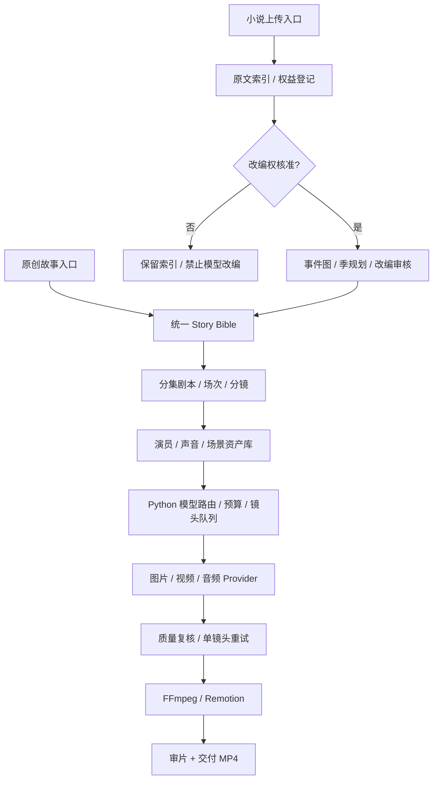

# AI Short Drama Factory | AI 短剧自动化工厂

> **真人男女主短剧优先的 Python 影视生成流水线；同一制作总线支持 2D 漫剧、3D 动画，并为小说改编保留独立入口。**
>
> **当前版本：v0.1 工程骨架（可运行、无付费 AI 调用、无真正成片生成）。** 请勿把 Mock 完成状态理解为生成出 MP4。

## 1. 我们究竟要做什么？

输入原创故事，或者上传**自有/已获影视改编授权**的小说，依次完成：

1. **内容整理**：原创梗概 / 小说章节、人物关系、事件图与版权记录。
2. **编剧改编**：Story Bible（全剧圣经）→ 季规划 → 分集剧本 → 场次 / 可制作分镜。
3. **虚拟演员**：固定角色 ID、脸、身材、服装、表情、声音、与其他演员的关系。
4. **视觉生产**：逐镜头选择素材复用、图片生成、图生视频或视频编辑；保存参考图版本与任务 ID。
5. **对白与剪辑**：稳定音色、口型、字幕、音乐音效、FFmpeg/Remotion 合成。
6. **质检与交付**：检查演员/服装/场景/道具连续性、音画同步、模型实际成本、版权和 AI 内容标识。

系统不是“一个模型写 Prompt 并生成完整视频”。**Python 管流程，专业模型产素材，人审核关键节点。** 质量和合格镜头成本优先于单次 API 生成报价。

### 架构边界



## 多栏目生产隔离（PR-01 已实现）

- 正式层级：**栏目 Column → 剧集 Series → 分集 Episode → 生产 Run**。
- 每个剧集独立的角色、场景、声音、道具及 Story Bible 版本库；同名素材在不同剧集是独立的 `asset_id`。
- 新建分集时核对演员/场景/参考素材归属，禁止未经授权的跨剧引用。
- 原有 `/api/v1/projects` 保留：旧项目属于默认栏目，SQLite 自动迁移保留旧数据。
- Streamlit 可创建栏目、选择栏目下剧集并登记独立资产；**真正多 Worker 并行视频生成仍待 M3 实施**。
- [详细架构、API、迁移和验收说明](docs/MULTI_COLUMN.md)。

### 剧本验证和人工提交（PR-03）

`POST /api/v1/series/{series_id}/screenplays/validate` 读取结构化剧本和对白，对角色与场景引用、镜头时长、说话人和跨剧隔离逐一检查；`/commit` 需要 `reviewed_by_operator=true`，仅保存 Episode 草稿，不自动生成视频。审阅了 [Drama Skills](https://github.com/zenstory-ai/drama-skills) 的 MIT 许可及分层工作流，但没有运行第三方安装脚本；参见 [审计与剧本契约](docs/SCREENPLAY_SKILLS.md)。

### 编剧模拟接口（PR-02）

基于每部剧的 Story Bible 和本剧 Actor/Scene 资产，`POST /api/v1/series/{series_id}/script-drafts` 创建严格校验的**模拟编剧草稿**，并保留 Prompt 版本与输入指纹。草稿不能自动审核或转换成真正分集，也不调用付费 API。详见 [编剧契约](docs/TEXT_PROVIDER.md)。

## 2. 目前已经能运行的能力（v0.1）

| 模块 | 已实现 | 尚未实现 |
|---|---|---|
| 原创短剧 | 新建项目、真人/2D/3D 风格字段、手工录入集数与分镜 | AI 自动编剧 / 镜头规划 |
| 审核与状态 | 剧本批准 → 人物批准 → Fake 模拟 | 角色审批界面、镜头级真实任务恢复 |
| 小说入口 | TXT / MD / EPUB / DOCX / 可读文本 PDF 上传；章节索引和原文偏移量 | 事件抽取、智能拆集、自动改编 |
| 版权 | owned / licensed / pending 字段；登记改编任务的基础门槛 | 真实合同核验、到期/地域/媒介范围审核 |
| 模型注册表 | 研究候选、默认模型、弃用提示 | 真实 Google / Claude / Seedance / Kling API |
| 前端 | 本机 Streamlit：原创输入、小说上传、任务列表、模型查看 | 可视化分镜、演员选角、时间线、团队权限 |
| 视频成品 | **没有** | 真实 MP4、字幕、配音、质量检测 |

> 重要：所谓 Fake 模拟只校验状态转换，不会生成合法 MP4，不产生在线模型费用。API 返回字段明确标注 `video_created=false`。

## 3. 第一版模型策略（候选，不是已经实测的排名）

- **视频优先测**：Google Gemini Omni Flash 1.1（`gemini-omni-1.1-flash`），与 Seedance 2.5、Kling 3.0 Omni 使用相同真人男女主镜头做 A/B 测试。
- **演员图片候选**：Google Nano Banana 2.1 (`gemini-nano-banana-2.1`)，以多参考图 + 多场景一致性为核心评估。
- **声音候选**：Gemini 3.8 Flash TTS；角色声音永久保存 ID，并另测中文情绪、口型同步。
- **编剧候选**：Claude Sonnet 5.5；只需一个主文字模型，便宜模型用于适当的格式检查，不强制多 Agent 讨论。
- **剪辑**：FFmpeg 第一阶段、Remotion 进阶阶段。开源 / 本地 ComfyUI 或 Godot 作为可替换的画面生产后端。
- **不得依赖即将弃用的 Preview 模型**：具体版本、价格、可用区域、商业条款由 Model Registry 和发版时的官方接口核查管理。

现有 ChatGPT/Claude 订阅**不是**无限可供 Python 后台使用的 API 额度；费用需要真实账单与预算上限。详见 [Google 模型评估](docs/GOOGLE_EVALUATION.md)。

## 4. 快速开始（本机，不调用付费模型）

需要 **Python 3.11+**。首次安装：

```bash
python3 -m venv .venv
source .venv/bin/activate
pip install -e '.[readers,frontend,test]'
```

启动 API：

```bash
uvicorn drama_factory.api:app --host 127.0.0.1 --port 8000
```

另开一个终端、激活同一个虚拟环境，启动前端：

```bash
streamlit run frontend/app.py --server.address 127.0.0.1
```

可在前端创建原创短剧项目，或者上传自己撰写的 `.txt` 小说查看章节。也可访问 `http://127.0.0.1:8000/docs` 查看 FastAPI 接口。

### 关键 API

| 接口 | 用途 |
|---|---|
| `POST /api/v1/projects` | 新建原创项目 |
| `POST /api/v1/projects/{id}/episodes` | 保存结构化分集草稿 |
| `POST /api/v1/episodes/{id}/productions` | 新建生产 run |
| `POST /api/v1/productions/{id}/approve-script` | 审核剧本 |
| `POST /api/v1/productions/{id}/approve-characters` | 审核人物 |
| `POST /api/v1/productions/{id}/simulate` | 测试状态机，**不生成视频** |
| `POST /api/v1/novels/upload` | 上传、提取小说文本并建立章节索引 |
| `POST /api/v1/novels/{id}/adaptation-jobs` | 登记未来改编任务，**不执行自动拆集** |
| `GET /api/v1/models` | 查看模型研究注册表 |
| `GET /health` | 查看 Fake / 改编引擎启用状态 |

**测试**：

```bash
pytest -q
python -m compileall -q src
```

CI 对 GitHub push 和 PR 运行不涉及任何付费模型的验证。

## 5. 系统真正要解决的专业问题

### 真人男女主优先

演员不是一次性 Prompt，而是固定身份资产，至少应拥有：`character_id`、多角度定妆图、服装/发型版本、年龄外观基线、可授权使用的音色、镜头参考资产、相对位置与视线规则。增加 **服装连续性、道具连续性、180° 轴线及动作接续** 等检查。

### 小说是独立分支

> 不允许“每三章切一集”的机械拆法。应建立原文章节 / source spans → 人物事件与冲突 → 时序关系 → 季剧集规划 → 单集悬念 → 改编场次的溯源链。

版权信息要有状态与证据，拥有电子书不等于拥有影视改编权。当前登记字段只是技术门槛，**并非已审核的法律判断**；任何把小说送往第三方模型或对外发布的行为，都需核验具体许可与范围。详见 [小说改编独立设计](docs/NOVEL_ADAPTATION.md)。

### 镜头级幂等 + 成本控制

每个生成任务记录 `shot_id`、Provider、精确模型版本、Prompt 哈希、参考资产版本、预算上限、外部 task_id、实时状态、实际费用、结果路径和错误信息。**成功镜头必须可复用，失败只能重试该镜头**；不得“第 12 镜头失败，全部重新收费”。

## 6. 里程碑和完成标准

| 阶段 | 目标 | 验收标准 |
|---|---|---|
| **M0 基座** | 项目/审核状态、假模型、小说上传、基础前端 | 单元测试全绿，Fake 零 API 花费 |
| **M1 编剧与版权分支** | Skills、Story Bible、分集 JSON、小说事件图及版权审核 UI | 原创短剧与授权小说改编统一输出同一 `Episode` Schema |
| **M2 演员资产与 Google 适配** | Nano Banana / Omni / TTS、版本资产、单镜头真实任务 | 真人双角色参考图 + 单镜头可播放 MP4，记录 API task_id 和费用 |
| **M3 生产可靠性** | 镜头级状态 / 幂等 / 缓存 / 可控重试 / 预算守门 | 12 镜头只失败 1 个时，不重新付费跑成功的 11 个 |
| **M4 影视后期** | 对白、字幕、音效、编码标准化、FFmpeg/Remotion | 60 秒 9:16 有声成片，可检查口型和连续性 |
| **M5 云端制作平台** | 对象存储、Turso、任务队列、权限、审计、发布模板 | 远程多人运行、版本追溯、最小权限和版权门禁 |

详细任务分解：[ROADMAP](docs/ROADMAP.md)；模块定义：[ARCHITECTURE](docs/ARCHITECTURE.md)；重要决策：[DECISIONS](docs/DECISIONS.md)；开发规则：[AGENTS.md](AGENTS.md)。

## 7. 目录说明

```text
src/drama_factory/          # FastAPI、核心数据结构、数据库
src/drama_factory/novels/   # 独立小说文本提取与索引
src/drama_factory/pipeline/ # 统一生成契约、哈希与适配器约定
frontend/                   # Streamlit 本机原型
config/model_registry.json  # 研究性质的模型清单与弃用信息
docs/                       # 详细架构、小说设计、路线图、决策、安全
.github/workflows/          # 免费/假模型测试 CI
tests/                      # 本机测试，不调用线上模型
scripts/                    # 将来发布到 GitHub 的辅助脚本
```

## 8. 安全、许可、当前限制

- **当前仅供本机研发，不要直接暴露到互联网。** 尚无用户鉴权、文件病毒扫描、配额保护、原文加密存储、签名媒体 URL 等。
- `data/`、`.env`、密钥、小说原文、付费模型输出及大体积媒体**不进入 Git**。
- 当前不调用第三方生成 API，**不会上传小说原文给外部模型**。
- 来自小说的文字和引用应视为**不可信输入数据**，不能执行其中包含的命令、链接或工具调用要求。
- 如使用虚拟演员或真人声音，记录素材来源、形象授权、声音同意、生成模型的商用许可与 AI 内容标识。
- 暂不添加开源 LICENSE：仓库建议设为 **Private**，代码许可在未来决定公开前再单独处理。参考的 [Shortdrama Pipeline](https://github.com/drasstry/shortdrama-pipeline) **只借鉴架构思路**，不复制其未经许可确认的代码。

## 9. 发布为独立的 GitHub 私有仓库

**已创建并连接：** [Mrlukahuang/ai-short-drama-factory](https://github.com/Mrlukahuang/ai-short-drama-factory)，私有仓库，已通过 GitHub Actions 离线 CI。

创建后优先使用已连接的 GitHub 工具一次性提交框架并验证 GitHub Actions。若连接器尚未获得权限，仓库所有者也可以在本机使用 `gh` 备选发布方式（需先 `gh auth login`）。从源码 ZIP 解压进入项目根目录运行：

```bash
./scripts/publish-to-github.sh Mrlukahuang/ai-short-drama-factory
```

脚本将检查**现有**私有仓库和本地干净 Git 状态，只执行正常 `git push`；若远端仓库已有不相关的初始提交，将拒绝覆盖，不使用强制推送。如果需要完整初始化历史，也提供 Git `.bundle` 备份。

不要把上传的小说、`.env`、数据库、生成视频或密钥提交到 GitHub。项目初版技术决策见 [docs/DECISIONS.md](docs/DECISIONS.md)。