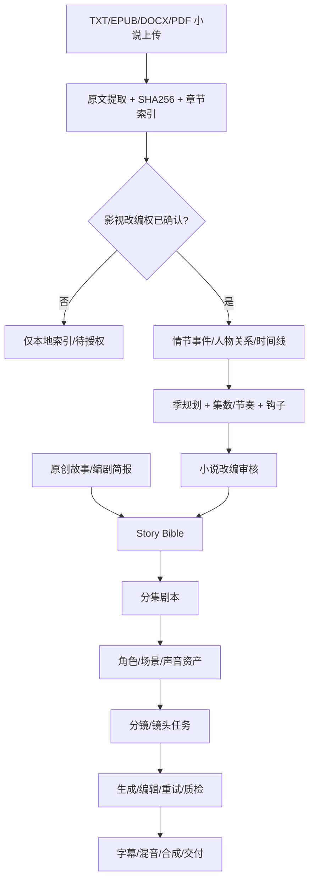

# AI Short Drama Factory — 体系结构 v0.1

## 核心约束

1. **真人剧优先**：角色 ID、服装版本、声纹/音色 ID、动作连续性、镜头轴线和道具状态为一等实体。2D、3D 动画使用相同的叙事和调度层，仅视觉适配器不同。
2. **一条通用生产总线、两个创作入口**：原创故事入口和小说/版权改编入口，汇聚于 `Story Bible -> Episode Script -> ShotPlan`。
3. **先校验权益，再进行改编**：导入供本地提取索引；只有授权状态和授权范围符合要求才允许进入改编队列；真实平台部署仍需要人工核验许可期限、地域、语言、改编类型及合同原件。
4. **所有视频调用均镜头级持久化**：Task ID、模型版本、prompt 哈希、参考资产版本、状态、费用、最后错误和成果位置。重试仅影响失败镜头。此项为下阶段实施，不属于当前最小工程。
5. **模型接入是可切换 Adapter**：Google Omni 1.1 优先，其他视频模型按质量盲测后上线。
6. **缓存必须版本化**：批准的演员、声音、服装、场景与镜头资产均不可原地覆盖。
7. **API 不发送小说原文到任何第三方**，直到正确授权且用户明确启动模型处理。

## 双入口

## 小说改编：不要直接按章节切集

小说中一章可能只有铺垫，一章也可能包含多个反转；剧集拆分应由剧本节奏而非章节数决定。

推荐独立阶段：

- **SourceIngestion**：源文件、哈希、格式、版次、版权声明、路径；本地解析，保留来源锚点。
- **ChapterIndexer**：原文段落编号、章节与 offset、无损引用；这是本版本已经实现的阶段。
- **PlotExtractor**：按章节识别事件、人物、时序、地点、伏笔与转折，关联 source spans。
- **SeasonPlanner**：确定总集数、每集时长、首 3 秒钩子、每集收尾悬念，保证剧情密度与改编范围。
- **EpisodeAdapter**：从情节图生成改编提纲、场次、对白、镜头，并保留对应的原文锚点。
- **Review**：要求人工核对改编范围、核心情节的忠实程度、潜在分歧，然后发布到通用 Story Bible。

这些阶段都必须能单独重试且以固定 JSON Schema 交换数据；任何一个阶段的模型换代都不应该改变后续视频流程。

## 后续版本进度

- v0.1：当前交付。原创建项、手工分集、审核状态机、Fake 模拟、小说原文上传/提取/章节索引、版权门槛、小说改编队列预留、模型注册表、Streamlit 原型。
- v0.2：插入编剧 Skill 和结构化 ScriptProvider；加入小说事件图、时间线、改编集数规划、回溯引用与版权证据审批 UI。
- v0.3：角色和声音库、Google 图像模型/Omni 视频 Adapter、输出媒体的真实校验、成本预估与审批。
- v0.4：完整镜头级幂等缓存、视频并发调度、音频对白同步、FFmpeg/Remotion 合成与样片 QA。
- v0.5：云端部署、存储对象化、权限、审计、真实模型盲测、分镜可视化编辑。

## Google 模型确认（2026-10-12）

- `gemini-omni-1.1-flash`：GA，Interactions API；3–10 秒，原生音频、9:16、图像引用、编辑和延长。中文原生对白必须测试；不能编辑声音或上传声音引用。
- `veo-3.1-*-preview`：Google 公布 2026-10-22 停用，禁止作为新系统默认生产版。
- `gemini-nano-banana-2.1`：图像/多参考角色资产候选。
- `gemini-3.8-flash-tts`：真人固定音色候选；后续需持久 voice ID 和许可跟踪。
- 仍保留 Seedance / Kling 对比测试，不根据官方演示直接确定质量优胜者。

官方文档：

- https://ai.google.dev/gemini-api/docs/omni
- https://ai.google.dev/gemini-api/docs/veo
- https://ai.google.dev/gemini-api/docs/deprecations/
- https://ai.google.dev/gemini-api/docs/pricing
- https://ai.google.dev/gemini-api/docs/models/gemini-nano-banana-2.1
- https://ai.google.dev/gemini-api/docs/speech-generation

## 部署与安全边界

当前本地 UI/API 未包含身份认证、病毒扫描、权限分区、加密的素材存储、任务队列和强制版权审核，**不能将本工程直接暴露在公共互联网或处理高价值版权文件**。生产前须增加鉴权（角色权限）、文件反病毒扫描、对象存储加密和签名下载、原文访问审计、权益日期和地域验证、企业密钥管理及可追溯的成本账本。
