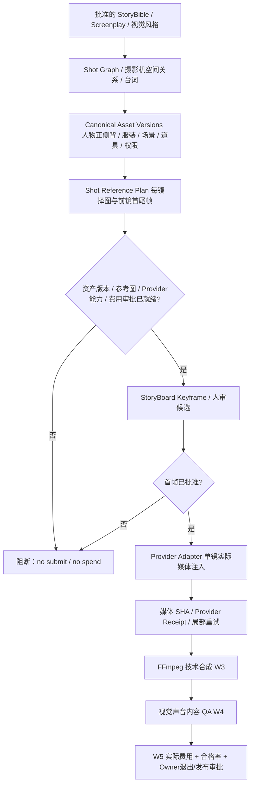

# G4/FND-00｜短剧工厂生产主脊架构审计：先收敛框架，再精修镜头

**Stage:** G4  · **Req:** R4.4（R4.3 自动内容 QA 维持独立） · **审计日期:** 2026-10-19 NZT
**审计 main:** `6215f481628e508085e7409752cd137feb372b6e` · **任务:** [Issue #181](https://github.com/Mrlukahuang/ai-short-drama-factory/issues/181)

> **这是研究与接口设计，不是生产功能合并或更改当前阶段。** 不授权新模型调用、视频生成、图片上传、收费服务或 G4 退出。原版12镜第一轮 Owner 聊天反馈说明系统性人物/道具漂移，但未作为正式 W4 人审 HMAC 导入。W5 `NOT_READY`、Issue #177 待决策保持不变。

## 1. 要解决的是整条流水线的控制失败

用户第一轮 s01–s12 审片反馈：多镜头中同一男女主的脸型/眼睛/服装变化，杯子尺寸与造型、桌面材质/卡片/抹布等道具和整体风格反复变化，中文对白可听但部分语义不合、s07 三格分屏。**不能用一次性文字描述重复、单镜 Prompt 润色或对12镜重新抽卡解决产线层面的漂移。**

### 已证实的本仓库数据断点

| 现有模块 | 实际能力 | 断点 |
|---|---|---|
| `pipeline/screenplay.py`、`screenplay_video_plan.py` | 角色 IDs、镜头顺序、动作/对白/风格 Prompt、单镜计划 | 各镜生成计划**未依赖前一镜已批准真实视觉帧**；角色参考是文字、不是可验证图片输入 |
| `assets/references.py`、`pipeline/local_asset_references.py`、`shot_reference_board.py` | 项目绑定、来源权限/图片哈希、本地人工选图与 Fingerprint | local shot board 明确 `model_use_approved=false`，没有到生成 Provider 的受控数据通道 |
| `pipeline/shot_asset_binding.py`（已交付 W2） | 逐镜角色/场景/服装/speaker 版本与 prompt SHA | `reference_images_supported=false`、`provider_reference_applied=false`、`production_assets_verified=false`，追加文字并不是真参考注入 |
| `providers/video_provider.py` | `VideoRequest.reference_images`、`audio_reference` 抽象已有 | 公共形状已有，但具体 Provider 并不消费图像 |
| `providers/google_omni_video.py` | 实际 `interactions.create(model=..., input=spec.prompt)` 及原生 AAC | `_omni_legacy_spec` 主动拒绝 `reference_images` 和 audio_reference；只能 prompt-only |
| `scripts/complete_gpt_episode.py`、`postprocess_gpt_episode_offline.py` | 历史真的12镜生成、串联/字幕草稿、FFmpeg 渲染、技术 receipt | 技术“有12镜”与内容“同人同物同风格”不是同一门禁 |
| W4 `pipeline/content_review.py` / W5 验收清单 | 真实媒体双版本 CLI / SHA 完整性、历史负例、独立内容/发布门禁 | **后验**发现漂移；缺少生成前资产准备与分镜首帧审批的**前置**约束 |

**根因诊断（证据等级）：** “参考资产到 Provider 输入断路”是源码确认的事实；“该断路导致了当前所有漂移”是高度合理、**尚未由真实A/B定量验证**的假设。即便接入图片，模型仍可能失败；需候选图与人审质量回路。中文对白独立于视觉参考图，不能误承诺靠三视图修复。

## 2. 同类项目热度快照与代码审核

**2026-10-19 GitHub API Star 数**，仅筛选与完整 AI 短剧产线直接相关者；不是性能、质量或许可证排名：

| 项目 / 固定 main HEAD | Stars | LICENSE 实测 / 直接代码复用 | 借鉴节点 |
|---|---:|---|---|
| [Toonflow-app](https://github.com/HBAI-Ltd/Toonflow-app/tree/d2e94aca7b59659ff6b4ca15f03cf134ec7f0e1d) | 18,130 | MIT，复制需保留版权 | Production nodes、StoryBoard Team、资产/媒体节点与模型插件边界；**不要搬 Electron/无限画布** |
| [huobao-drama](https://github.com/chatfire-AI/huobao-drama/tree/26de7df59806588e98e103a21bd0bfd26d4a55a6) | 16,351 | CC BY-NC-SA 4.0；**只借思路** | `backend/src/services/generation.ts` 参考图+首尾帧参数；`video-prompts.ts` `@角色/@场景/@道具` 明确镜头引用 |
| [waoowaoo](https://github.com/waooAI/waoowaoo/tree/dfec20e32298ed675050329e4a41477024148399) | 14,586 | Elastic 2.0；**只借思路** | 对多阶段制片与长任务恢复分工；不引入其整套 Temporal/Next.js |
| [ViMax](https://github.com/HKUDS/ViMax/tree/fd4b72e7731be6e5f88486206d25ea59849b0285) | 12,687 | MIT；最值得优先复用可隔离模块 | `agents/character_portraits_generator.py` 正面→参考正面生成侧/背；`agents/reference_image_selector.py` 按镜位选角度与上镜帧；`pipelines/script2video_pipeline.py` camera tree/portrait registry；`agents/best_image_selector.py` 首帧候选筛选 |
| [Jellyfish](https://github.com/Forget-C/Jellyfish/tree/a9678194ddf2d9be3ccbe78d4287d87d5089e123) | 6,773 | Apache-2.0；优先复用契约/局部 Python | `shot_assets.py` 四类逐镜关联，`shot_character_links.py` 角色关联；`shot_video_readiness.py` 和 `generation/video/build_context.py` 强制参考模式 `first/last/key/first_last` 的帧就绪 |
| [ArcReel](https://github.com/ArcReel/ArcReel/tree/8d9d3a00d9b7cd6c1d119ad303206dc2d57ddf7f) | 5,575 | AGPL-3.0；只借设计 | `lib/references/reference_catalog.py` 资产名称空间/派生关联；`lib/workflow/workflow_rules.py` 规则依赖 |

**不同赛道，单列：** [OpenMontage](https://github.com/calesthio/OpenMontage/tree/c8066452325cb57c8fc1ba8c2a71b6e8842e6b65) 69,580★ / AGPL（`lib/checkpoint.py` 门禁/恢复理念）；[HyperFrames](https://github.com/heygen-com/hyperframes/tree/8434945784b5378358a1c661aa080e1894533578) 66,895★ / Apache-2.0（合成/时间轴，不解决生成时角色漂移）。大 Star 不能代表更适合“同脸短剧”。

**许可证警告：** Toonflow 老版的商业补充条款与当前仓库 MIT LICENSE 发生过版本变更，因此只评估**此处固定源码树**、依赖及各目录 NOTICE；下游改用上游新 commit 时重新查 License。Huobao/waoowaoo/OpenMontage/ArcReel **禁止直接复制**到当前私有项目，除非另行完成合规评估。ViMax/Jellyfish 也不意味着整个 SDK/平台可以无条件迁入；只在必要时拷贝最小函数、保留版权和 attribution。

## 3. 目标：Python-owned Visual Production Spine

### 3.1 Canonical Asset Registry：不是再建数据库

复用现有 `series_assets`、`assets/references.py` / local media，建立**只读/离线清单投影**。每件角色、服装、场景、道具都固定：
`asset_id`、`kind`、`variant`、`version`、`sha256`、`provenance/rights`、`approved_by`，角色视角 `front|side|back`（视情况有 `three_quarter`），场景 `master_layout`、桌面与道具尺寸。画风 `felt_diorama` 独立统一 Style ID/SHA。**不存在批准图时不可用文字锚点冒充。**

### 3.2 Shot Graph：分镜不再12镜彼此独立

`shot_id`、`scene_id`、`speaker`、`camera_angle`、`screen_direction/axis`、`character_ids`、`costume_ids`、`prop_ids`、`dependency_shot_ids`、`approved_previous_frame_sha`、`approved_first_frame_sha`。在保持原有 script/order 不变的基础上新增可选上游**编排投影**；相机依赖用于选择“同场景近期已有参考帧”，不能乱序改变剧本。

### 3.3 Shot Reference Plan：不是无脑三视图全传

角色先选**当前视角最适合的一张**正/侧/背参考；再选择必要的衣着、桌面布局/场景、关键道具或经人工批准的上一镜尾帧。每个引用必须 `role`、`asset_id`、`asset_version`、`image_sha`、`rights_verified`、`model_use_approved`、`source_shot_sha?` 和确定性排序。超出供应商限额则给出明示选择/阻断，**不静默丢图或退回纯 Prompt**。

### 3.4 Preflight & Provider：准确证明媒体真的送进模型

Google [官方 Omni 文档](https://ai.google.dev/gemini-api/docs/omni) 允许 `input` 数组附图片和文字，并用 `<IMAGE_REF_N>`、`<FIRST_FRAME>` / `<LAST_FRAME>` 绑定媒体用途，也可按需声明 `reference_to_video`。**这说明供应商有能力，不说明我们的当前 Provider 已实现、已校验其数量/大小或输出有效。**

新能力必须支持 dry-run/Fake 序列化、请求摘要（不得写 API Key、私人图像或完整敏感提示）、零模型调用和能力检测。缺图、错版权、不支持的媒体数、上游已失效、未经批准的实际 remote submission 一律**fail closed**。真实付费生成仍由单镜显式 Operator 新授权；`max acknowledged spend` 不是供应商硬成本上限。

### 3.5 候选首帧 / Continuity QA / 失败恢复

首帧的多候选生成与“与人物/道具一致”的排序只在获授权后调用模型；**最初先用已有本地静态参考和假候选离线测通**。经人工认可的首帧版本作为下游依据。某一镜来源变化，只有依赖该镜的镜头候选/生成计划失效；其余已有真实 clip SHA 继续保留。W4 内容 QA 仍独立阻断发布，不能由 model score 改写 owner 审片。

### 3.6 中文对白单列

视觉三视图不能确保中文对词、语义、声线或口型。W2 既有 `speaker/expected_dialogue` 必须保留；未来真实可核对的 ASR/人耳记录要比对原句、speaker、时序；未授权 #177 远程 ASR 时仍为 `not_run`。

## 4. G4 内最小分步实施（**不是 G5/W6**）

| 包 | 允许改动/复用 | 退出标准 | 实际付费 |
|---|---|---|---|
| **FND-00 本 PR** | 本审计文档和 Issue #181；不改生产 | 根因、上游固定源/许可、文件级薄适配、停止条件清楚 | USD0 |
| **FND-01 离线产线合同** | 新模块：Asset Catalog 投影 + ShotGraph/ReferencePlan/Readiness；只读重用 W2 和本地图片/现有 schema | 12-shot offline plan、缺参考/错版本/错主体/无权利阻断、依赖失效单测。无 Provider 调用 | USD0 |
| **FND-02 Provider 接线的 Fake/模拟** | 独立多模态 request-preparer + Fake adapter；正式生产 Provider 默认关闭 | 数组顺序、正确 `IMAGE_REF` 标志、SHA、权限、SDK约束合同离线验证；`reference_applied` 只有**真实可证明**才可真 | USD0 |
| **FND-03 分镜首帧及审核门禁** | 复用已有 FFmpeg、W4 review/既有本地帧投影；不搬新的前端/数据库 | 同场景复用、候选首帧审批后才可提交，变化只失效后代；无费演练 | USD0 |
| **FND-04 最小真实 A/B（单独审批）** | 两至三个相邻镜 vs 原 prompt-only，分别有批次成本/参考SHA/人工同脸、道具和音频质量判断 | 真正 reference 请求 receipt + 新授权费用/权利批准 + 明确质量差值；再决定是否修12镜 | **不批准不得执行** |

**旧证据保护：** W1–W5 已交付源码和历史真实12镜不改、不重跑付费；W3 后期、W4 内容 QA、W5 审计与退出门仍为权威；不动 AMEND-001 冻结的 TTS/storage/Turso、CI/gov 文件，不修改生产表结构、不新增 UI。

**治理冲突：** `AMEND-006` 原文称毛毡风格“定妆照暂不需要，等 Omni adapter 支持参考图后再评估”。现真人审片提供新反例，但**代理不能自己编辑 Active AMEND**；在 Owner 明确治理更新或单独授权生产策略切换之前，FND-01/02 只做 zero-cost offline contracts，不把多图默认启用生产，也不关闭 #177 或改 G4 状态。

## 5. 架构通过的可核验 DoD

- **输入**：一份固定剧本 + 两个演员已批准正/侧/背图的版本+同一咖啡店场景/杯/桌/服装资产版本，来源权利明示（没有真正图片则仅用本地 synthetic fixtures 做离线测试）。
- **输出**：12个镜头各自的 ShotGraph 和 deterministically selected image plans，选图 SHAs、相机/角色/场景、上镜继承原因、Provider preflight/Fake 请求 envelope SHA；12个生成请求即便无费、也要可复核到底传了什么。
- **拒绝**：缺图、未授权、外来人物、版本漂移、错 scene/prop、模型不支持、超最大输入数量、真实费用未授权、旧 SHA 复用、镜头先后不一致；所有拒绝**不能默默回退成纯文字成功**。
- **真实外部指标（FND-04 之前只是 `not_run`）**：同一对角色在相邻镜的身份/服装/道具一致性经人工评分明显优于旧基线；中文对白单独验收；有费用回执且没有旧视频重跑；技术/内容/发布门各自独立，G4仍在。
