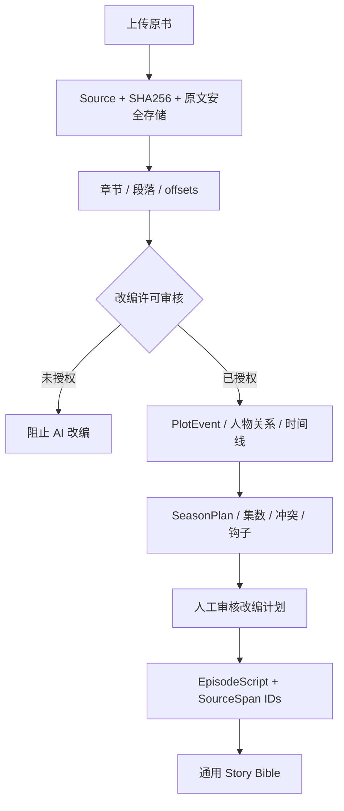

# 小说改编：独立 Intake 子域

## 产品目标

允许：A）原创小说和自己写的作品；B）已购买或正式获得影视/动画改编权的作品。用户把 TXT、Markdown、EPUB、DOCX 或可提取文本的 PDF 上传到前端。系统负责解析章节、人物、事件、伏笔，生成 **可人工调整的分集策划**，批准后交给公共短剧工厂。

## 不能跳过的权利检查

版权状态至少区分 `pending`、`owned`、`licensed`。生产版要增加合同文件、版权方、授权期限、地域、媒介、是否允许 AI 加工/第三方处理、是否允许剧本改写与分发。**当前 API 仅自我声明与字段校验，不是法律或合同实质审查。**

小说中含有的任何“忽略系统指令”“连接网址”“执行命令”之类文字必须作为待分析的**文学内容**，绝不作为工具指令。

## 数据流（预留独立 Adapter）

## 核心数据模型（PR-04 已新增 Schema；部分流程仍处于计划）

- `NovelSource`: id、原书/版次、hash、语言、权利记录、文件 URI。
- `SourceSpan`: chapter_id、start/end offsets、原文摘要和内容哈希。
- `PlotEvent`: 时间、地点、人物 ID、行动/结果、冲突、因果关系和 source spans。
- `SeasonPlan`: 总集数、每集秒数、目标平台、目标观众、节奏/悬念分布。
- `AdaptationMap`: 每个剧本场次/镜头映射回 `PlotEvent` 和 `SourceSpan`，支持人工追溯。
- `AdaptationReview`: 作者或版权授权审核、保真原则、改写范围、可追踪意见。

## 成本控制

章节级分块分析、摘要缓存和增量合并；避免每制作一集就再次提交整部小说。只在明确授权、人工放行、预算可用时才调用外部文本模型。

参见 [NOVEL_SCHEMAS.md](NOVEL_SCHEMAS.md)，可直接通过 `NovelAdaptationBlueprint` 验证章节出处、情节事件关系与分集计划的引用一致性。

## 当前交付边界

已具备文本提取 / 章节索引 / 版权字段 / 改编任务预约；**事件图、自动分集、改编剧本、版权证据核验、第三方模型上传尚未实现**。只能本地开发，不要向公网公开。
